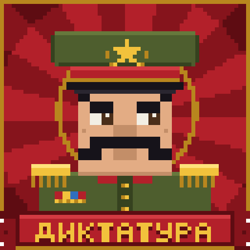

# Diktatura — мод «Диктатура» для Minecraft 1.21.1 (Fabric)



Мир превращается в государство с вождём. Действуют законы, за нарушения
положены штрафы, конфискация, таймаут или арест. Арестованного скоростная повозка
везёт на отработку (мини-игру), а потом он сидит в камере. Диктатор-NPC раз в 5 минут
издаёт указы и меняет законы. Отдельно, в случайные моменты, происходят события:
амнистия, подарки, конфискация, «один глаз», невесомость.
У каждого игрока своя шкала лояльности и страха.

- Minecraft **1.21.1**, Fabric Loader 0.16+, Fabric API, Java 21.
- Логика работает на сервере (и на встроенном сервере одиночной игры).
  Клиенту нужен мод для HUD, книги законов и переводов.
- 31 закон, тексты на русском и английском.
- Версии: каждый релиз лежит на странице [Releases](https://github.com/Amorsev/diktatura-mod/releases)
  (тег `vX.Y.Z` — код версии, к релизу приложен jar). Что менялось — в [CHANGELOG.md](CHANGELOG.md).

## Как собрать и запустить

1. Установите JDK 21 и IntelliJ IDEA.
2. Откройте папку проекта в IDEA как Gradle-проект. IDEA сама скачает Gradle 8.12
   (из `gradle/wrapper/gradle-wrapper.properties`), Minecraft и маппинги.
   Если хотите запускать из терминала, один раз выполните `gradle wrapper`,
   и появятся `gradlew` / `gradlew.bat`.
3. Запуск клиента: задача Gradle `runClient`. Сервера: `runServer`.
4. Сборка jar: `build`. Файл появится в `build/libs/diktatura-<версия>.jar`.

GitHub Actions (`.github/workflows/build.yml`) собирает мод после каждого push.
Готовый jar лежит в артефактах сборки.

## Что внутри

| Модуль | Класс | Что делает |
| --- | --- | --- |
| LawRegistry | `law/LawRegistry` | Читает законы из `data/<ns>/diktatura/laws/*.json`, `/reload` перечитывает |
| LawEngine | `law/LawEngine`, `law/Checks` | Подписка на события и проверка законов для каждого игрока |
| PunishmentSystem | `punishment/*` | Штраф, конфискация, арест, таймаут, эффекты, лояльность, молния, урон |
| PrisonSystem | `prison/*` | Тюрьма у спавна (NBT-структура), камеры, сроки, освобождение |
| Отработка | `minigame/*` | Мини-игры перед сроком: паркур, каменоломня, лабиринт |
| TransportSystem | `transport/TransportSystem` | Скоростная повозка: везёт в тюрьму и обратно на точку задержания |
| StateManager | `state/*` | Сохранение в мире (PersistentState): лояльность, законы, сроки, точки задержания |
| Dictator | `dictator/Dictator` | NPC на троне, указы о законах по фиксированному таймеру |
| События | `event/*` | Случайный таймер, одно событие за раз |
| Лояльность | `loyalty/*` | Рост без нарушений, слежка и обыски, награды; паранойя от страха; подполье и восстание |
| Ценности | `wealth/*` | Оценка богатства: Upgrader или своя таблица |
| UI (клиент) | `client/*`, `client/ui/*` | HUD-панели, баннеры, заголовки, субтитры, плакаты, окно НПС, книга законов (предмет и клавиша **L**) |
| UI (сервер) | `ui/Hud`, `ui/Voice` | Что и кому показать: баннер, заголовок, реплика НПС с субтитрами в радиусе 32 блоков |
| НПС | `npc/NpcInteractions` | Общее окно для всех ведомств: обработчик на ведомство, кнопки проверяются на сервере |
| Network | `network/*` | Статус для HUD, пакеты UI (`UiPayloads`), нажатия кнопок в окне НПС |

### Арест: отработка, затем камера

1. При аресте запоминаются координаты и измерение. Вещи игрока сдаются на хранение
   и вернутся, когда он доедет домой.
2. Повозка — деревянная телега, в которую впряжён гражданин-заключённый в полосатой робе
   (модели из Blockbench), — везёт игрока прямо в зону отработки. Высадиться нельзя,
   урон не проходит. Если цель дальше 600 блоков или в другом измерении, повозка взлетает и
   «прыгает» к цели.
3. Отработка — одна из трёх случайных мини-игр. Зоны висят в небе в 60 блоках над тюрьмой:
   - **паркур**: допрыгать до золотой площадки, на середине есть контрольная точка, упал — начинай с неё;
   - **каменоломня**: добыть 64 камня выданной киркой. Камень сразу восстанавливается, ничего не выпадает;
   - **лабиринт**: найти выход (золотой блок в дальнем углу).
4. После отработки игрок садится в камеру на **10–60 секунд**. Срок начинает идти
   только с этого момента и только пока игрок в сети. Закон может задать свой срок:
   `{"type": "arrest", "seconds": 45}` или `"min_seconds"` / `"max_seconds"`.
5. После срока та же повозка везёт игрока на точку задержания, возвращает вещи и режим игры.
   Ещё 5 минут после этого «постоянные» законы его не трогают.
6. Во время ареста игрок неуязвим. Если сервер перезапустился посреди отработки, срока
   или поездки, всё восстанавливается при следующем входе.

Тюрьма ставится один раз при первом запуске мира, в 40 блоках к востоку от спавна
(`prisonOffsetX/Z`). Постройка: `data/diktatura/structure/prison.nbt`, генератор —
`tools/gen_prison.py`. Зоны отработки строит код (`minigame/MinigameZones`).

### Интерфейс

- Слева сверху — панели «Гражданин» (лояльность, страх), «Статус» (только когда есть что
  показать) и «Указ» (таймер до следующего указа).
- Сверху по центру — баннеры (до трёх): указы, события, аресты. Опасные мигают красным.
- Указ, чрезвычайное положение и восстание объявляются крупным заголовком с полосами.
- Реплики НПС — субтитры над хотбаром с печатной машинкой и стрелкой к говорящему.
- При аресте — плакат «РАЗЫСКИВАЕТСЯ», при смене измерения — «государственная загрузка».
- Клавиша **H** прячет панели мода (баннеры и заголовки остаются).
- Книга законов (**L**): вкладки «Действующие», «Отменённые», «Мои лицензии» и поиск. Будущие законы заранее не видны.
- Всё рисуется кодом через `DrawContext`, без текстур и миксинов в рендер.

### Столица-гора (новые миры)

В 40 блоках к востоку от спавна при создании мира вырастает гора (настройка `capitalMountain`).
Внутри — тюрьма, к её воротам с западного подножия ведёт тоннель; на вершину ведёт лестница
по западному склону. На плато — большой тронный зал, к северу дом госучреждений, к югу госказино.
Генератор — `world/Capital.java`, зал — `dictator/GrandThroneHall.java`.

### Диктатор и указы

Вождь (отдельный НПС `diktatura:dictator` в мундире и короне, неуязвимый, не двигается)
стоит на троне в своём тронном зале (отдельное здание к северу от тюрьмы, вход с запада)
и следит глазами за подошедшими. Удар по вождю — покушение: минус 30 лояльности и арест. ПКМ по нему
открывает окно вождя: реплика (голосом и субтитрами), сводка и кнопки. Раз в 5 минут (фиксированный таймер) он издаёт указ:
вводит новый закон, отменяет действующий или заменяет один на другой. Число действующих
законов держится в пределах 6–12. Законы с `"permanent": true` не отменяются никогда.

### События

У событий свой таймер, случайный: раз в 3–8 минут. Одновременно идёт только одно событие,
отсчёт до следующего начинается, когда текущее закончилось.

| Событие | Длительность | Что происходит |
| --- | --- | --- |
| Амнистия | мгновенно | Освобождаются все арестованные (только если есть кого) |
| Подарки | мгновенно | Каждый на свободе получает случайный подарок |
| Конфискация | мгновенно | Изымается одна группа: золото, железо, уголь, факелы, сладости, стрелы, цветы или мясо |
| Один глаз | 30 секунд | У каждого игрока чёрная левая или правая половина экрана |
| Невесомость | 3–5 раз по 5 секунд | Гравитация отключается на 5 секунд, потом 5 секунд обычная, и снова. Урона от падения нет |

События касаются только игроков на свободе (амнистия — наоборот, арестованных).

### Лояльность и страх

На законы ни лояльность, ни страх не влияют: законы для всех одинаковы.

- От 0 до 100, у каждого игрока свои. Старт лояльности: 50.
- **Лояльность** — как вас видит государство. Без нарушений +1 в минуту.
  - 20 и ниже — «неблагонадёжный»: подсвечен для всех, иногда обыскивают.
  - 80 и выше — почётный гражданин: каждые 10 минут премия 5 трудодней и «Герой деревни».
- **Страх** — паранойя. Растёт от наказаний, без нарушений спадает на 2 в минуту.
  При страхе 70+ лояльность растёт вдвое быстрее. Чем выше страх, тем чаще мерещится
  (раз в 30 секунд шанс до ~45%), и видения только у самого игрока:
  - от 20 — шаги за спиной;
  - от 35 — шёпот доносов («…на тебя уже написали донос…»);
  - от 50 — **фантомный налоговый инспектор**: стоит поодаль на краю поля зрения и смотрит.
    Подойдёшь или посмотришь в упор — растворится в дыму;
  - от 70 — фальшивый указ вождя на весь экран, через пару секунд — «…показалось».
  Проверить: `/diktatura test fear <уровень>`.

### Восстание

Само не начинается — его поднимают игроки **подпольными листовками** (2 бумаги + красный краситель
→ 4 листовки, ПКМ — разбросать).
- Решатся только неблагонадёжные (лояльность ≤ 40) и не запуганные (страх < 60).
- Если рядом чиновник, железный голем или служебный гусь — листовки изымут, страх +15.
- Каждая листовка — шаг «брожения умов»; когда наберётся 8 (`rebellionLeaflets`), вспыхивает
  восстание: на 5 минут перестают действовать все законы, кроме постоянных. Брожение утихает само —
  одна листовка раз в 5 минут.
- Ночью восстание становится **Кровавой луной** до рассвета: красное небо, мобов вдвое больше,
  силовики, двойники, спать нельзя. Сама по себе луна не приходит (`bloodMoonEveryNights` = 0).

## Формат закона

Файл `data/<namespace>/diktatura/laws/<id>.json`. Название и описание берутся из
перевода `law.<namespace>.<id>` и `law.<namespace>.<id>.desc`.

```json
{
  "check": {"type": "wealth", "threshold": 12800, "include_ender_chest": false},
  "punishments": [
    {"type": "arrest", "minutes": 5},
    {"type": "loyalty", "amount": -5}
  ],
  "cooldown_seconds": 900,
  "prevent": false,
  "enabled_by_default": true,
  "permanent": true,
  "weight": 10
}
```

- `prevent` — отменить само действие (сломать блок, написать в чат, ударить, использовать предмет).
- `enabled_by_default` — закон действует с начала мира.
- `permanent` — диктатор не отменяет его, и он действует во время восстания.
- `weight` — шанс, что диктатор выберет закон для нового указа (0 — никогда).

### Проверки (`check.type`)

| Тип | Параметры | Нарушение |
| --- | --- | --- |
| `look_up` | `min_angle` (60) | Смотрит вверх круче угла |
| `outside_at_night` | — | Ночью под открытым небом |
| `sprinting`, `sneaking`, `in_water` | — | Бежит, крадётся, в воде |
| `hunger` | `max_food` (6) | Сытость не выше значения |
| `hold_item` | `items`, `tag` | Предмет в руке |
| `have_item` | `items`, `tag`, `min_count` | Предмет в инвентаре |
| `wealth` | `threshold`, `include_ender_chest` | Ценность инвентаря выше порога |
| `altitude` | `above` / `below` | Выше или ниже высоты |
| `equipment` | `slot`, `required`, `items`, `tag` | Нет обязательного или есть запрещённый предмет в слоте |
| `dimension` | `dimensions` | Находится в измерении |
| `standing_on` | `blocks`, `tag` | Стоит на блоке |
| `block_break` | `blocks`, `tag`, `state_structures` | Ломает блок (`state_structures: true` — только в постройках мода: тюрьма, тронный зал) |
| `gamble` | — | Ставка в госказино |
| `block_place` | `blocks`, `tag`, `max_build_height`, `state_structures` | Ставит блок, постройка выше N, в постройках мода |
| `chat` | `words`, `regex`, `caps_ratio`, `min_length`, `any` | Сообщение в чате |
| `kill_entity`, `attack_entity` | `entities`, `tag` | Убил или ударил существо |
| `use_item` | `items`, `tag` | Использует предмет |
| `sleep` | — | Лёг спать |

### Наказания (`punishments[].type`)

`warning`, `fine` (`item`, `amount`), `confiscate` (`mode`: `offending` / `held` / `random`),
`arrest` (`seconds` или `min_seconds` / `max_seconds`), `timeout` (`seconds`: молчание в чате и замедление),
`effect` (`effect`, `seconds`, `amplifier`), `loyalty` (`amount`), `lightning`, `damage` (`amount`).

## Дом госучреждений и график чиновников

К северу от тронного зала стоит дом госучреждений с двумя кабинетами: трудовая биржа (Кадров)
и лицензионный отдел (Печаткин). Чиновники работают по «гибкому графику»: на месте
`officeOpenMinSeconds`–`officeOpenMaxSeconds` секунд, затем отсутствуют
`officeClosedMinMinutes`–`officeClosedMaxMinutes` минут, у каждого свой случайный график.
Режим — на табличке и индикаторе у двери, открытие и закрытие объявляются баннером, `/diktatura office`.

## Трудодни и работы

Трудодни — виртуальная валюта (не предмет). Зарабатываются на работах у товарища Кадрова
(трудовая биржа в доме госучреждений к северу от тронного зала), видны в HUD, `/diktatura money`.

Работа — файл `data/<namespace>/diktatura/jobs/<id>.json`:

| Поле | Что значит |
| --- | --- |
| `type` | `courier`, `cleaner`, `miner`, `lumberjack`, `builder` |
| `name` | ключ перевода названия |
| `order` | порядок в списке вакансий |
| `minutes` | срок |
| `reward` | оплата за выполнение |
| `unit_reward` | оплата за каждую единицу (платится и при опоздании) |
| `late_fine` | штраф за опоздание |
| `variants` | для счётных работ: `label`, `goal`, `blocks` (id или `#тег`), необязательный `reward` |
| `min_distance`, `max_distance` | доставщик: на каком расстоянии от биржи ждёт получатель |
| `blueprints` | строитель: список чертежей `{label, layers, reward}`; `layers` — слои снизу вверх, строки — Z, символы — X; любой символ, кроме «.», — королевский блок. Стройка идёт на парящей королевской площадке, готовая постройка улетает |

## Ведомства-события

- **Налоговик** и **почтальон** приходят к игроку сами (`visitMinMinutes`–`visitMaxMinutes`):
  налог 13% трудодней (квитанция об уплате спасает от одной проверки), посылка-сюрприз.
- **Реклама** на 13 секунд (`adMinMinutes`–`adMaxMinutes`, 0 — выключить): плакат «ГосТВ» с товаром,
  ценником, наклейкой и бегущей строкой. «Пропустить» убегает от курсора, но после четырёх
  попыток сдаётся. Если открыт инвентарь или чат, реклама дождётся, пока его закроют и **госрадио** в чате
  (`propagandaMinutes`).
- **Ведомство погоды** (`weatherMinMinutes`–`weatherMaxMinutes`): коровопад, наковальнепад,
  гуманитарная помощь.
- Штраф в законе (`"type": "fine"`) без `item` списывает трудодни (`amount`), с `item` — предметы.

## Механики и госпредметы

- Сундук-ревизор: сундук с добычей иногда оказывается мимиком и изымает вещи при укусе (`mimicChance`).
- Первый вход в Незер и Край — долгая госзагрузка на 8 секунд (`firstVisitLoading`).
- Кричащая еда: иногда еда протестует или агитирует, когда её едят (`screamingFoodChance`).
- Падающие деревья (`timber`): подрубленное дерево падает от игрока, ствол ложится брёвнами,
  кого накроет — получает урон, обвалы под землёй (`caveInChance`), простуда (`coldAfterSeconds`,
  `coldMinutes`) — лечится казённым чаем.
- Ластик канцелярии стирает протокол ареста; тапок правосудия (бумеранг) и госпушка (лучи) — по рецептам.
- Таможенник со служебными гусями (`diktatura:corrupted_goose`) изымает «импорт» из Незера и Края.
- Дикие гуси (`diktatura:wild_goose`) бродят по лугам и воруют вещи из рук; убитый гусь роняет добычу.
  Подселение стаек рядом с игроками отключается опцией `wildGeese`.

## Эмиграция руды

При добыче руда может отрастить ножки и убежать (алмазы — чаще всех). Догнали — двойной улов,
не догнали — через две минуты закапывается обратно. Шахтёрская лицензия вдвое снижает шанс
(`runawayOre`, `runawayDiamondChance`, `runawayOreChance`).

## Спорный контент

- Бюро проверки гражданства: капча у стола зачарований, наковальни, эндер-сундука, варочной стойки
  и стола кузнеца (`captchaChance`, 0 — выключить).
- Комендантский час с двойником: нарушителю ночью является двойник-агент (`curfewDouble`).
- Мобы-силовики: зомби-стройбат и снайперы госохраны (`enforcerMobs`, `builderZombieChance`,
  `sniperSkeletonChance`).
- Препарат с искажениями — странные грибы (`distortionDrug`, по умолчанию включён). Грибы растут
  пятнами по всему верхнему миру и в тени деревьев рядом с игроками. Сытные (7 голода), но после
  них полминуты одного из восьми трипов: мир вверх ногами, перепутанные кнопки, «вертикальное
  видео», графика-картошка, невесомость, турбо, лаги с откатом назад, глюки реальности.
  Проверить любой: `/diktatura test trip <эффект>`.

## Финальный бой

1. **Дракон госохраны** — дракон Края вдвое больше обычного, с рогами и светящимися кристаллами,
   три фазы и атаки по одной (`dragonHealth`).
2. **Вождь без охраны** — после гибели дракона ударьте вождя, и он встанет с трона (`dictatorHealth`).
   Драконобой на вождя не действует.
3. **Ничья по-диктаторски** — на 5% здоровья вождь объявляет ничью: участникам орден, 50 тд
   и иммунитет от законов (`immunityDays`). Всё вместе отключается опцией `finalFight`.
- В `exempt_license` закона можно указать работу: `"job:lumberjack"` — исключение для тех, кто на ней.
- Новые проверки законов: `sneeze` (`near_players` — радиус, в котором должны быть другие игроки).

## Госказино

Три стола и три крупье: рулетка (товарищ Фортунов), игровой автомат (товарищ Барабанов) и кости
(товарищ Кубиков). Ставки в трудоднях. Игру видно на столе: колесо крутится, барабаны вертятся,
кости летят; итог показывается табличкой над столом. Шансы подкручены открыто: в окне крупье рядом
официальный и фактический шанс. Выигрыш облагается налогом, ставок в час не больше лимита.
Настройки — `data/diktatura/diktatura/casino.json`.

## Лицензии

Пять лицензий продаёт товарищ Печаткин (лицензионный отдел в доме госучреждений), за трудодни:

| Лицензия | Цена | Срок | Что разрешает |
| --- | --- | --- | --- |
| Шахтёрская | 60 | 3 дня | Добычу руды; обвалы вчетверо реже, руда убегает вдвое реже |
| Портальная | 50 | 2 дня | Выезд в Незер и Край |
| Лесная | 35 | 2 дня | Рубку деревьев (работа лесоруба тоже освобождает) |
| Водная | 20 | 2 дня | Купание и ныряние |
| Игорная | 40 | 2 дня | Игру в казино, когда действует закон «Азартные игры — только по лицензии» |

**Лицензируемые занятия** — рубка леса, добыча руды, выезд за границу, купание — требуют лицензии
**всегда**, это не законы: вождь их не вводит и не отменяет. Без лицензии — штраф в трудоднях (нечем
платить — минус 3 лояльности); шахтёра и лесоруба на работе от биржи не штрафуют. О них игрок узнаёт,
только нарушив: первое нарушение открывает в книге законов скрытый раздел «Лицензируемые занятия»,
и каждое новое нарушение добавляет туда запись — что за занятие, какая лицензия нужна, сколько стоит,
какой штраф и есть ли она у вас. Игорная лицензия работает по-старому — через закон.

Покупка продлевает уже купленную лицензию. При аресте лицензии аннулируются. 1 игровой день = 20 минут.
Файл лицензии: `data/<namespace>/diktatura/licenses/<id>.json` — `price`, `days`, `order`,
`revoke_on_arrest`, `for_sale`; закон снимается лицензией через `"exempt_license"`.

## Формат НПС

Файл `data/<namespace>/diktatura/npcs/<id>.json`, текстура `assets/<namespace>/textures/entity/npc/<id>.png`
(раскладка обычного скина 64×64, модель игрока). У НПС самого мода — свои модели из Blockbench
(см. «Модели Blockbench» ниже), у НПС из датапаков — модель игрока со скином. Пример — вождь:

```json
{
  "name": "entity.diktatura.dictator",
  "role": "diktatura.npc.dictator.role",
  "accent": "#D4A017",
  "phrase_prefix": "diktatura.dictator.say.",
  "phrase_count": 12,
  "sound": "minecraft:entity.villager.ambient",
  "pitch": 0.6,
  "scale": 1.15,
  "held_item": "diktatura:scepter"
}
```

`name`, `role` и реплики (`phrase_prefix` + номер от 0 до `phrase_count - 1`) — ключи переводов.
Все поля необязательны. Без своей логики НПС показывает в окне имя, ведомство и случайную реплику.

## Модели Blockbench

Исходники лежат в `blockbench/models/*.bbmodel` — их можно открыть и поправить в Blockbench.

- **НПС** (вождь, налоговый инспектор, таможенник, курьер, крупье рулетки и костей, оператор автоматов,
  сотрудник биржи, лицензиар, получатель посылок, заключённый) — формат «Модовая сущность», скелет гуманоида
  (`head`, `hat`, `body`, `right_arm`, `left_arm`, `right_leg`, `left_leg` + свои детали), текстура 128×128.
- **Повозка госперевозки** (`wagon.bbmodel`) — телега с колёсами, оглоблями и флажком, текстура 128×256;
  `blockbench/gen_wagon.py`.
- **Оружие вождя** — скипетр, мегафон пропаганды, тапок правосудия и книга законов: «Модель для Minecraft JE».

Как обновить мод после правки: экспортировать НПС через «Экспорт → Модовая сущность» (версия 1.17+ Yarn)
в `<id>.java`, предметы — «Экспорт → Модель JSON» в `item_<id>.json`, положить рядом `.bbmodel` и запустить
`python blockbench/import_models.py <папка>`. Модели с нуля пересобирают `blockbench/gen_npcs.py`
и `blockbench/gen_items.py` (сценарии для Blockbench и текстуры).

## Команды

Для всех:
- `/diktatura laws` — действующие законы.
- `/diktatura status` — своя лояльность, страх, срок.
- `/diktatura wealth` — оценка своего имущества.

Для операторов:
- `/diktatura law list | enable <id> | disable <id>`
- `/diktatura decree [new_law|repeal|swap]` — указ о законах сейчас
- `/diktatura event [amnesty|gifts|confiscation|blind_eye|no_gravity|stop]` — событие сейчас или остановить текущее
- `/diktatura arrest <игрок> <секунды>` (срок в камере после отработки), `/diktatura release <игрок>`
- `/diktatura loyalty <игрок> <0–100>`, `/diktatura status <игрок>`, `/diktatura wealth <игрок>`
- `/diktatura prison tp | rebuild | minigame <parkour|quarry|maze>` (последняя — посмотреть зону)
- `/diktatura ui alert | headline | speech | wanted` — проверить новый интерфейс (показывает только себе)
- `/diktatura throne tp | rebuild` — к тронному залу, перестроить зал
- `/diktatura money` — свой счёт и последние операции; `/diktatura job` — текущая работа
- `/diktatura money <игрок> [сумма]`, `/diktatura money reset`, `/diktatura job cancel <игрок>` — трудодни и работы игроков
- `/diktatura office` — кто из чиновников на месте; `/diktatura office open | close <employer|licensor> | tp | rebuild` — для операторов
- `/diktatura casino tp | rebuild` — к госказино, перестроить его
- `/diktatura bureau tax | courier | customs | ad | cows | anvils | aid | cold | sneeze | cavein` — вызвать ведомство или механику прямо сейчас
- `/diktatura license` — свои лицензии; `/diktatura license give | revoke <игрок> <id>` — выдать или отозвать
- `/diktatura npc list | spawn <id> | dictator` — список НПС, поставить НПС на своё место, проверить вождя на троне
- `/diktatura finale guard_down | start | stop | reset` — снять охрану, сразу начать бой с вождём, остановить его, вернуть охрану
- `/diktatura finale dragon_attack <атака>` — дракон госохраны проводит атаку сейчас (нужен дракон в Крае)
- `/diktatura bloodmoon start | stop` — Кровавая луна сейчас (днём сначала наступает ночь) или закончить её
- `/diktatura test double | captcha | trip <эффект>` — двойник-агент (днём тоже), капча без блока, грибной эффект (даже если опция выключена)

## Настройки

Все настройки можно менять в игре: кнопка у мода в Mod Menu или «Настройки» внизу книги законов
(в одиночной игре). Подсказка к каждой — при наведении на название.

`config/diktatura.json` создаётся при первом запуске: интервал указов (`decreeIntervalMinutes`,
по умолчанию 5; старое значение 20 заменяется автоматически), случайный интервал событий
(`eventMinMinutes` / `eventMaxMinutes`, 3–8), число импульсов невесомости
(`gravityPulsesMin` / `gravityPulsesMax`, 3–5), срок в камере
(`minSentenceSeconds` / `maxSentenceSeconds`, 10–60), пределы числа законов, лояльность, восстание, положение тюрьмы, скорость повозки, освобождение
операторов и творческого режима от законов, интеграция с Upgrader.

## Интеграция с Upgrader

У Upgrader (Modrinth: `upgrade-items`) нет публичного API, а лицензия ARR не разрешает
копировать код. Мод делает так:

1. Если в конфиге заданы `upgraderValueClass` и `upgraderValueMethod`, вызывает этот
   метод рефлексией. Метод должен принимать `ItemStack` или `Item` и возвращать число.
2. Иначе ищет в jar Upgrader класс со словами value / price / worth в имени и подходящим методом.
3. Читает конфиг Upgrader из `config/` (`valueOverrides`, `globalValueMultiplier`,
   `valueMultipliers`, `blacklist`) и применяет его к своей таблице.
4. Если ничего не нашлось, работает своя таблица `data/diktatura/diktatura/item_values.json`
   (алмаз 256, незеритовый слиток 2304 и т. д.; порог 12800 ≈ 50 алмазов).

Что именно подключилось, видно в логе сервера и в `/diktatura wealth`. Если поиск не нашёл
метод, откройте jar Upgrader (например, в IDEA), найдите метод оценки и пропишите его в конфиг.

## Открытые вопросы

- Сверка механик с видео leafxup «DICTATORSHIP MOD»: транскрипта пока нет.
- Учитывать ли сундуки в пороге богатства. Ender-сундук уже включается флагом
  `include_ender_chest`, обычные сундуки не учитываются.
- Своя модель и текстура вождя (сейчас это житель-простак с именем), звуки, текстура книги.

## Лицензия

MIT (см. `LICENSE`). Части мода основаны на моде-референсе Gr1tW4lk (MIT), звуки — CC0; подробности в `CREDITS.md`.
